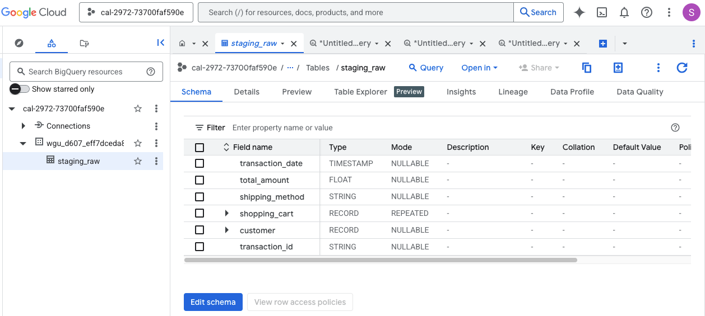
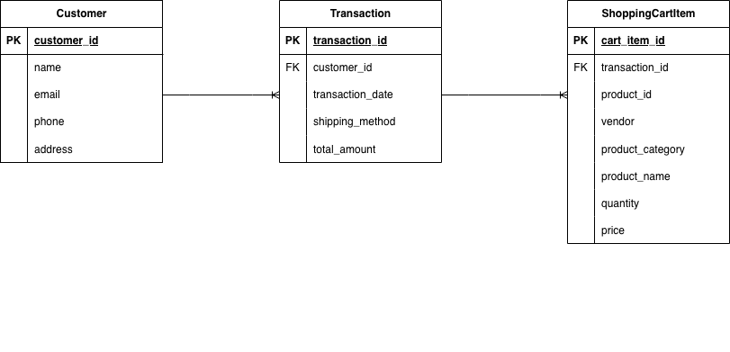
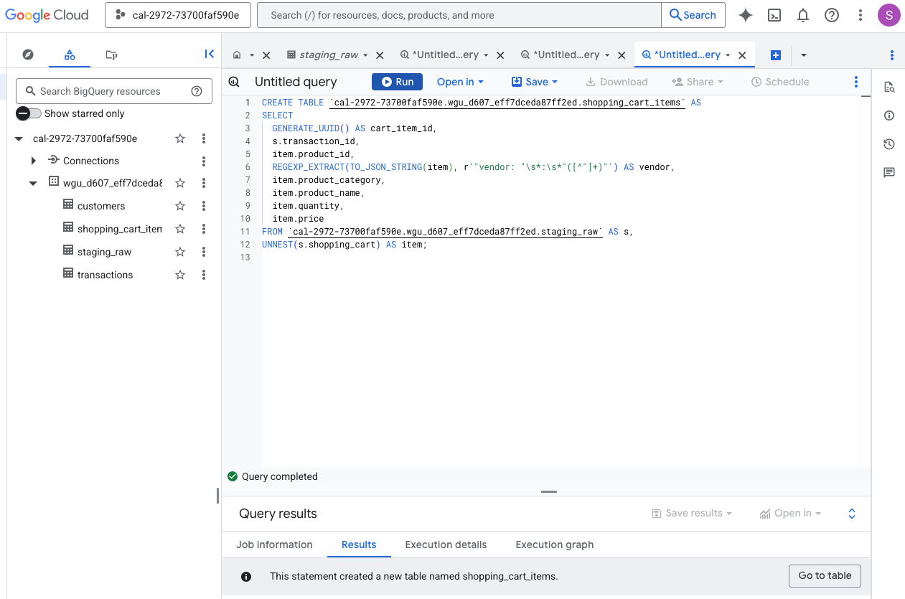
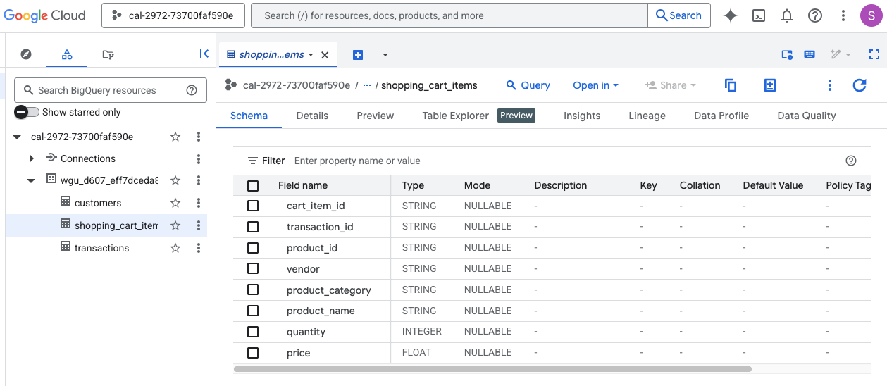
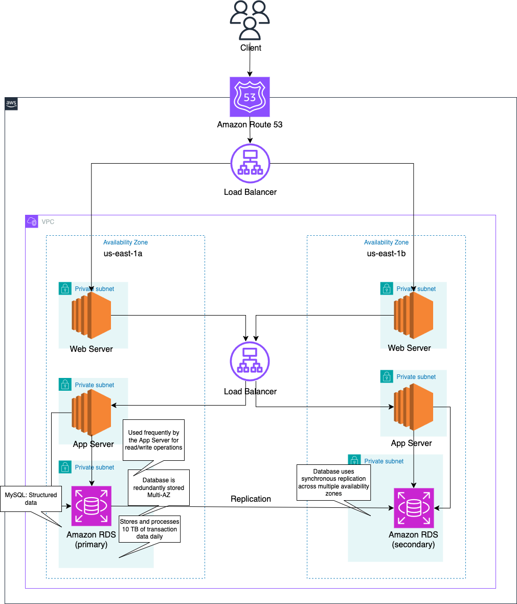

# Alliah Company: E-Commerce Data Warehouse in BigQuery

**How do you turn deeply nested e-commerce JSON into clean, queryable warehouse tables, when the source data has a malformed field that schema auto-detection can't handle?**

Alliah Company is a fictional online retailer moving its transaction data from on-premises storage to the cloud. This project has two parts:

1. **Planning:** requirements, cloud architecture, backup and disaster recovery strategy, and a relational data model.
2. **Implementation:** loading 10,000 nested JSON transactions into Google BigQuery and transforming them into three normalized tables (customers, transactions, and shopping cart items) using SQL.

> This project was completed as part of the Western Governors University M.S. Data Analytics program (D607 Cloud Databases). WGU provided the business scenario and source dataset. The data model, architecture, and all SQL were designed and written independently. The dataset is synthetic; a 20-record sample is included in `data/`.

## Data Flow

```
TransactionData.json → jq → transactions.ndjson → BigQuery staging_raw → SQL (UNNEST, CTAS) → customers, transactions, shopping_cart_items
```

1. **Convert:** the source file is a single JSON array, but BigQuery loads JSON one object per line. `scripts/convert_to_ndjson.sh` converts it to newline-delimited JSON with `jq`.
2. **Stage:** the NDJSON file is loaded into a `staging_raw` table with schema auto-detection. Each row is one transaction with a nested `customer` record and a repeated `shopping_cart` array.
3. **Transform:** three `CREATE TABLE AS SELECT` statements flatten the nested data into normalized tables.
4. **Clean up:** `staging_raw` is dropped once the final tables are built.



## Data Model



| Table | Grain | Key | Rows |
|---|---|---|---|
| `customers` | One row per customer | `customer_id` | 10,000 |
| `transactions` | One row per order | `transaction_id` (FK: `customer_id`) | 10,000 |
| `shopping_cart_items` | One row per product line in an order | `cart_item_id` (surrogate, FK: `transaction_id`) | 29,774 |

Each transaction contains between 1 and 5 cart items, covering 1,000 products from 30 vendors across 10 product categories.

## SQL Scripts

| Script | What it does |
|---|---|
| `sql/01_create_customers.sql` | Flattens the nested `customer` record into one row per customer |
| `sql/02_create_transactions.sql` | Extracts order-level fields and casts `transaction_date` to `TIMESTAMP` |
| `sql/03_create_shopping_cart_items.sql` | Uses `UNNEST` to turn the cart array into one row per item, generates a surrogate key, and recovers the vendor field |
| `sql/04_drop_staging.sql` | Drops the staging table to avoid paying for duplicate storage |
| `sql/05_validation_checks.sql` | Checks row counts, key uniqueness, orphaned foreign keys, order total reconciliation, and vendor recovery |



## Data Quality Issues

**Malformed vendor key.** In the source JSON, every cart item stores the vendor under the key `"vendor: "`, with a trailing colon and space, instead of `"vendor"`. Because of the colon and space, the field can't be referenced as `item.vendor` in SQL. To recover it, each cart item is serialized back to JSON with `TO_JSON_STRING` and the value is pulled out with `REGEXP_EXTRACT`, producing a clean `vendor` column.

**No natural key for cart items.** `transaction_id` plus `product_id` is not unique, because the same product can appear twice in one cart (26 cases in this dataset). Each cart item gets a generated surrogate key, `cart_item_id`, instead.

## Validation

`sql/05_validation_checks.sql` confirms the transformation didn't lose or duplicate data:

| Check | Expected result |
|---|---|
| Row counts | 10,000 customers, 10,000 transactions, 29,774 cart items |
| Primary key uniqueness | 0 duplicates in each table |
| Orphaned foreign keys | 0 transactions without a customer, 0 items without a transaction |
| Order totals vs. line items | 0 orders where `total_amount` differs from `SUM(quantity * price)` |
| Vendor recovery | 0 null vendors, 30 distinct vendors |



## Planning: Proposed Cloud Architecture

The planning phase proposed an AWS architecture for production scale (about 10 TB of transaction data per day): Amazon RDS (MySQL) for transactional data, deployed across two Availability Zones with synchronous replication for failover, Amazon Redshift for analytics, and AWS Glue for ETL. Backups use daily incremental snapshots copied to a secondary region for disaster recovery. Data is encrypted at rest with AWS KMS and in transit with TLS, with IAM role-based access control.



## Next Steps

- Declare primary and foreign keys as BigQuery table constraints so the relationships are documented in the schema and available to the query optimizer.
- Partition `transactions` by `transaction_date` to reduce query costs as data grows.
- Replace `GENERATE_UUID()` with a deterministic key built with `FARM_FINGERPRINT` from the transaction ID and the item's position in the cart (`UNNEST ... WITH OFFSET`), so rebuilding the table produces the same keys.
- Standardize phone number formats, which vary in the source (for example `(933)745-1993`, `429.490.1112x53344`, `+1-645-587-4355`).

## Tools & Technologies

Google BigQuery · SQL · jq · AWS (architecture design)
